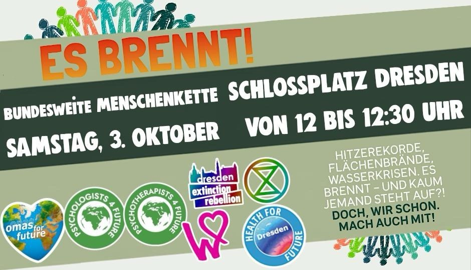

Hitzerekorde, Flächenbrände, Wasserkrisen - „beim Spiel Klimavernunft gegen Realitätsverweigerung steht es gerade gefühlt 1:3” (ARD-Meteorologe Sven Plöger, Extremwetterkongress 2026). 

Macht mit bei den Menschenketten am 03.10.2026 überall im Land. Wir reichen uns friedlich die Hände: über Landesgrenzen, politische Grenzen, Glaubens- und Sprachgrenzen hinweg.

⏰ Wann: Samstag 03.10.2026, 12:00–12:30 Uhr (seid gern schon 15 Minuten eher da)

📍 Wo: Schlossplatz Dresden

Wir stehen gemeinsam auf:

- für den Erhalt unserer Lebensgrundlagen
- für das konsequente Einhalten unseres Grundgesetzes
- für eine Politik, die das Wohl aller vor den Profit weniger stellt
- den konsequenten Vorrang erneuerbarer Energien
- konsequente Änderungen bei Mobilität, Ernährung, Wohnen und weiteren Bereichen

Es brennt und kaum jemand steht auf?! Doch, wir schon!

Weitere Infos: 

* [EsBrennt.com](EsBrennt.com)
* [https://www.gruenesbrett.net/veranstaltung/oyqz7u4hbpzrn](https://www.gruenesbrett.net/veranstaltung/oyqz7u4hbpzrn)