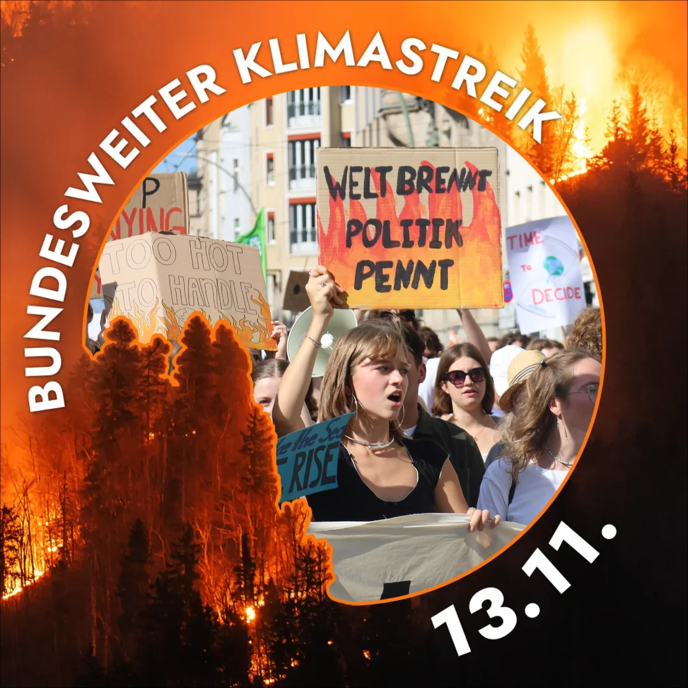

Die Klimakrise ist auch eine Gesundheitskrise. Hitzewellen belasten den Körper und können tödlich sein: In Deutschland gab es 16.000 Hitzetote. Die Folgen extremer Hitze und zunehmender Klimakatastrophen machen deutlich, dass Klimaschutz auch bedeutet, die Gesundheit und das Leben von Menschen zu schützen.

Deshalb ist **Health for Future Dresden** bei der Aktion **#PayYourClimateDebt** dabei. Deutschland trägt eine historische Verantwortung und muss das versprochene und notwendige Geld bereitstellen, damit das Pariser Klimaabkommen eingehalten werden kann. Zeitgleich verhandeln bei der COP 31 in Antalya Länder aus aller Welt darüber, wie mit der Klimakrise umzugehen ist.

Mit einem Standbild auf dem Theaterplatz setzen wir mit Fridays for Future Dresden ein Zeichen: Gesundheit braucht konsequenten Klimaschutz und globale Klimagerechtigkeit. Unsere Zukunft und die Gesundheit der Menschen dürfen nicht ignoriert werden.

Wann: Nächsten Freitag, 17 Uhr
Wo: Theaterplatz, Dresden

Kommt vorbei und setzt gemeinsam mit uns ein Zeichen für Gesundheit und Klimagerechtigkeit!